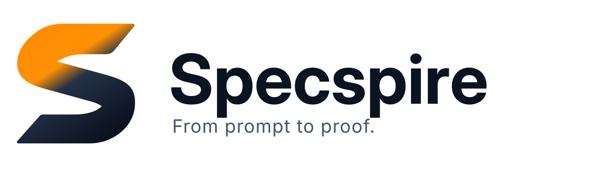

<p align="center">
  <picture>
    <source media="(prefers-color-scheme: dark)" srcset="assets/brand/logo-with-tagline-dark.svg">
    <source media="(prefers-color-scheme: light)" srcset="assets/brand/logo-with-tagline-light.svg">
    
  </picture>
</p>

<p align="center">
  <strong>Una Skill bilingüe para agentes de IA: especificación, TDD estricto y entrega basada en evidencias.</strong>
</p>

<p align="center">
  <a href="README.md">English</a> •
  <a href="docs/QUICKSTART.md">Inicio rápido</a> (<a href="docs/en/QUICKSTART.md">en</a>) •
  <a href="docs/WORKFLOW.md">Flujo</a> (<a href="docs/en/WORKFLOW.md">en</a>) •
  <a href="docs/QUALITY.md">Calidad</a> (<a href="docs/en/QUALITY.md">en</a>) •
  <a href="https://github.com/Nachovn114/specspire/blob/main/docs/BRAND.md">Marca</a> •
  <a href="https://github.com/Nachovn114/specspire/blob/main/docs/case-studies/TASKFLOW_ES_CASE_STUDY.md">Casos de estudio</a>
</p>

<p align="center">
  <a href="https://github.com/Nachovn114/specspire/actions/workflows/ci.yml"></a>
  <a href="LICENSE"></a>
  
  
</p>

```bash
# Instala la Skill verificada directamente desde GitHub en cualquier proyecto:
npx skills add Nachovn114/specspire --skill specspire
```

> **Aviso Beta:** La matriz de CI en GitHub Actions aprueba en Ubuntu, Windows y macOS (Node.js 20, 22, 24). La instalación remota de la Skill y la activación en Fase 0 con Google Antigravity están verificadas. La instalación remota del kit completo y agentes no testeados continúan **NOT VERIFIED**. Consulta el [Changelog](CHANGELOG.md) para el historial completo.

## Por qué Specspire

Los agentes de IA suelen saltar directo al código, agregar infraestructura innecesaria y reportar pruebas que nunca ejecutaron. Specspire les proporciona un único punto de entrada `SKILL.md` que carga bajo demanda 30 referencias técnicas (15 en español + 15 en inglés) a través de siete fases disciplinadas.

```text
Contexto → Especificar → Plan y diseño → Tareas → Construir (TDD) → Verificar → Entregar
```

1. **Contexto (`PROJECT.md`):** Problema, usuarios, límites y alcance.
2. **Especificar (`spec.md`):** Criterios de aceptación observables y casos borde.
3. **Plan y diseño (`plan.md`, `design.md`):** Arquitectura mínima y [diseño UI responsive](docs/DESIGN.md).
4. **Tareas (`tasks.md`):** Incrementos verticales con comprobación verificable.
5. **Construir (TDD):** Ciclos estrictos RED → GREEN → REFACTOR con pruebas reales.
6. **Verificar (`review.md`):** Reconciliación de requisitos vs realidad; [gates de calidad](docs/QUALITY.md).
7. **Entregar:** Comandos reproducibles, evidencias de ejecución y cierre limpio.

## Cómo empezar

- **Solo Skill remota (Recomendado):** Ejecuta `npx skills add Nachovn114/specspire --skill specspire` y apunta tu agente a `.agents/skills/specspire/SKILL.md`. Ver [Inicio rápido](docs/QUICKSTART.md).
- **Skill-only:** Usa `SKILL.md` directamente en la conversación sin requerir archivos locales del proyecto.
- **Kit completo (Código fuente):** Ejecuta `node ./bin/specspire.mjs init` y `doctor` para inicializar plantillas. Ver [Referencia CLI](docs/CLI.md).

```text
Instrucción para el agente:
"Usa la Skill specspire. Lee AGENTS.md y PROJECT.md.
Quiero desarrollar [funcionalidad]. Identifica la fase actual, propón la siguiente tarea y cómo verificarla."
```

## Compatibilidad verificada y Casos de estudio

| Plataforma / Agente | Estado | Notas |
|---|---|---|
| **T3 Code / Antigravity ACP** | PASS | Ciclo completo de 7 fases verificado en Piloto 1 (TaskFlow ES) y Piloto 2 (LogLens CLI). |
| **Google Antigravity** | PASS | Descubrimiento interactivo y ruteo multiescenario verificados. |
| **Matriz CI (Linux / Windows / macOS)** | PASS | Pruebas automáticas en Node.js 20, 22 y 24. |
| **OpenAI Codex** | BLOCKED | CLI 0.166.0 y estructura de Skill verificadas; inferencia bloqueada por cuota de cuenta en Paso 20G.4. |
| **Claude Code / Cursor** | NOT VERIFIED | Formato estándar de Skill compatible; sin evidencia de ejecución directa en el entorno. |

Descubre nuestros pilotos reales:
- <a href="https://github.com/Nachovn114/specspire/blob/main/docs/case-studies/TASKFLOW_ES_CASE_STUDY.md">Caso de estudio TaskFlow ES</a>: Cliente web responsive (320px–1440px), privacidad local y aserciones Playwright/Vitest.
- <a href="https://github.com/Nachovn114/specspire/blob/main/docs/case-studies/LOGLENS_CLI_CASE_STUDY.md">Caso de estudio LogLens CLI</a>: Analizador de logs en streaming con cero dependencias runtime, CLI POSIX y 40 aserciones nativas de Node.js.

## Documentación

| Tema | Español | English |
|---|---|---|
| Inicio rápido | [docs/QUICKSTART.md](docs/QUICKSTART.md) | [docs/en/QUICKSTART.md](docs/en/QUICKSTART.md) |
| Flujo de desarrollo | [docs/WORKFLOW.md](docs/WORKFLOW.md) | [docs/en/WORKFLOW.md](docs/en/WORKFLOW.md) |
| Controles de calidad | [docs/QUALITY.md](docs/QUALITY.md) | [docs/en/QUALITY.md](docs/en/QUALITY.md) |
| Estándares UI y responsive | [docs/DESIGN.md](docs/DESIGN.md) | [docs/DESIGN.md](docs/DESIGN.md) |
| Referencia de la CLI | [docs/CLI.md](docs/CLI.md) | [docs/CLI.md](docs/CLI.md) |
| Manual de marca visual | <a href="https://github.com/Nachovn114/specspire/blob/main/docs/BRAND.md">docs/BRAND.md</a> | <a href="https://github.com/Nachovn114/specspire/blob/main/docs/BRAND.md">docs/BRAND.md</a> |

[Contribuir](CONTRIBUTING.es.md) • [Seguridad](SECURITY.md) • [Changelog](CHANGELOG.md) • <a href="https://github.com/Nachovn114/specspire/blob/main/docs/BRAND.md">Manual de marca</a> • [Licencia MIT](LICENSE)
