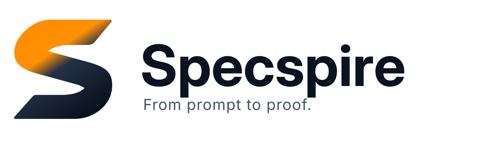

# Sistema de Identidad Visual — Specspire (Brand Identity V2)

Guía técnica oficial del sistema visual, proporciones, paleta cromática, variantes y directrices de aplicación de la marca Specspire.

---

## 1. Principios de Identidad

- **Claridad e ingeniería:** La marca comunica rigor metodológico, ingeniería de software verificable y reproducibilidad.
- **Sobriedad:** Aplicaciones deliberadamente austeras y profesionales; sin apariencia de mascota de IA, sello comercial de certificación ni plantilla promocional genérica.
- **Honestidad técnica:** Separación estricta entre evidencia verificada y afirmaciones no probadas (*From prompt to proof*).

---

## 2. Elementos Fundamentales

### 2.1 Nombre y Wordmark
- **Nombre oficial:** **Specspire** (con inicial mayúscula 'S', sin guiones ni espacios).
- **Tagline:** *From prompt to proof.*
- **Subtítulo de rol:** *One Agent Skill for verifiable software engineering.*
- **Trazado tipográfico:** Basado en la tipografía **Inter Display Bold** (diseñada por Rasmus Andersson, licenciada bajo **SIL Open Font License 1.1**). Los glifos han sido convertidos a contornos vectoriales (*outlines*) dentro de los archivos SVG para garantizar máxima fidelidad y renderizado idéntico sin dependencias tipográficas externas.

### 2.2 Símbolo (Monograma S)
- Monograma estilizado en forma de 'S', trazado con curvas de Bézier cúbicas precisas y limpias.
- En modo oscuro, el gradiente asciende desde el naranja de señal hacia el blanco roto (*off-white*).
- En modo claro, el gradiente transiciona desde el naranja de señal hacia el azul marino (*navy*).
- El símbolo no representa un sello legal de garantía ni un isotipo de certificación formal.

---

## 3. Paleta Cromática Oficial

| Color | Hex | Función / Aplicación |
|---|---|---|
| **Navy** | `#0B1220` | Fondo principal en modo oscuro; color primario de texto y wordmark en modo claro. |
| **Orange** | `#FF8A00` | Acento de señalización e identidad; uso restringido para énfasis y puntos focales. No usar como color de texto en párrafos. |
| **Off-white** | `#F5F7FA` | Tipografía principal y contraste sobre fondo Navy; base del monograma en modo oscuro. |
| **Slate** | `#94A3B8` | Tipografía secundaria, metadatos y bordes sutiles en modo oscuro. |

### Colores complementarios de soporte
- **Slate Dark:** `#485466` (texto secundario y bordes en fondos claros).
- **Pure White:** `#FFFFFF` (soporte de contraste en documentos impresos).

---

## 4. Variantes de Logotipo y Assets Disponibles

Los archivos maestros de marca se encuentran organizados en el directorio [assets/brand/](../assets/brand/):

| Archivo | Formato | Descripción y Uso |
|---|---|---|
| [`logo-dark.svg`](../assets/brand/logo-dark.svg) | SVG | Logotipo horizontal optimizado para fondos oscuros (GitHub Dark Mode). |
| [`logo-light.svg`](../assets/brand/logo-light.svg) | SVG | Logotipo horizontal optimizado para fondos claros (GitHub Light Mode). |
| [`logo-with-tagline-dark.svg`](../assets/brand/logo-with-tagline-dark.svg) | SVG | Logotipo con tagline completo para cabeceras en modo oscuro. |
| [`logo-with-tagline-light.svg`](../assets/brand/logo-with-tagline-light.svg) | SVG | Logotipo con tagline completo para cabeceras en modo claro. |
| [`mark-dark.svg`](../assets/brand/mark-dark.svg) | SVG | Símbolo independiente para modo oscuro (naranja a off-white). |
| [`mark-light.svg`](../assets/brand/mark-light.svg) | SVG | Símbolo independiente para modo claro (naranja a navy). |
| [`mark-monochrome-navy.svg`](../assets/brand/mark-monochrome-navy.svg) | SVG | Símbolo monocromático en Navy para impresión o favicons claros. |
| [`mark-monochrome-white.svg`](../assets/brand/mark-monochrome-white.svg) | SVG | Símbolo monocromático en blanco para fondos oscuros sin gradientes. |
| [`readme-header.png`](../assets/brand/readme-header.png) | PNG (1600×420) | Cabecera estática pre-renderizada con márgenes de seguridad. |
| [`avatar-512.png`](../assets/brand/avatar-512.png) | PNG (512×512) | Avatar oficial para perfil de organización o bot. |
| [`favicon.svg`](../assets/brand/favicon.svg) / `favicon.ico` | SVG / ICO | Icono de pestaña web y marcadores. |
| [`assets/social-preview.png`](../assets/social-preview.png) | PNG (1280×640) | Tarjeta Open Graph / Social Preview oficial para GitHub. |

---

## 5. Reglas de Uso y Escalas Mínimas

### 5.1 Escala y Legibilidad
- **Lockup completo con tagline:** Ancho mínimo recomendado: **240 px**.
- **Logotipo horizontal sin tagline:** Ancho mínimo recomendado: **140 px**.
- **Monograma independiente (gradiente):** Tamaño mínimo recomendado: **24 px**.
- **Monograma independiente (monocromático):** Recomendado para tamaños pequeños (**16 px** a **20 px**), como favicons de navegador o indicadores de terminal.

### 5.2 Área de Seguridad
- Mantener una zona libre de interferencias alrededor del símbolo aislada de al menos **0.25 veces el ancho del monograma**.
- Alrededor del lockup completo, respetar una separación mínima equivalente a la altura de la mayúscula (*Cap Height*).

### 5.3 Restricciones Estrictas de Marca
1. **No alterar proporciones:** No estirar, comprimir, distorsionar ni sesgar la relación de aspecto del símbolo ni del wordmark.
2. **No cambiar colores:** Utilizar exclusivamente la paleta oficial aprobada.
3. **No invertir fondos de forma incoherente:** No colocar el wordmark navy sobre fondo oscuro ni tipografía blanca sobre fondo blanco.
4. **No agregar efectos ornamentales:** Prohibido el uso de sombras difusas, biseles, bordes tridimensionales o halos de luz.
5. **No usar como viñeta decorativa:** El monograma no debe utilizarse repetitivamente como viñeta de listas o bullet point.

---

## 6. Integración en GitHub

### 6.1 Cabecera Adaptativa (Dark / Light Mode)
El repositorio GitHub implementa la cabecera adaptable mediante la etiqueta estándar `<picture>` de HTML en los README:

```html
<p align="center">
  <picture>
    <source media="(prefers-color-scheme: dark)" srcset="https://raw.githubusercontent.com/Nachovn114/specspire/main/assets/brand/logo-with-tagline-dark.svg">
    <source media="(prefers-color-scheme: light)" srcset="https://raw.githubusercontent.com/Nachovn114/specspire/main/assets/brand/logo-with-tagline-light.svg">
    
  </picture>
</p>
```

Esta técnica garantiza renderizado nítido a cualquier resolución y adapta automáticamente los colores al tema de la interfaz del usuario.

### 6.2 Social Preview de GitHub
- Archivo oficial: `assets/social-preview.png` (resolución exacta: 1280×640 px, peso aproximado: 32 KB).
- Fondo sólido Navy `#0B1220`, símbolo centrado con márgenes amplios y tagline *From prompt to proof.*

---

## 7. Licencia, Procedencia y Advertencias de Marca

- **Tipografía:** Inter Display © Rasmus Andersson, bajo licencia [SIL Open Font License 1.1](https://openfontlicense.org).
- **Procedencia del diseño:** Reconstrucción geométrica vectorial original en curvas Bézier, derivada de la exploración de identidad visual para Specspire.
- **Aviso legal de marca:** Specspire es un proyecto de software de código abierto. Esta guía define convenciones de uso y consistencia de diseño; la marca no se presenta como registrada (*® / ™*), certificada ni con exclusividad jurídica formalizada.
