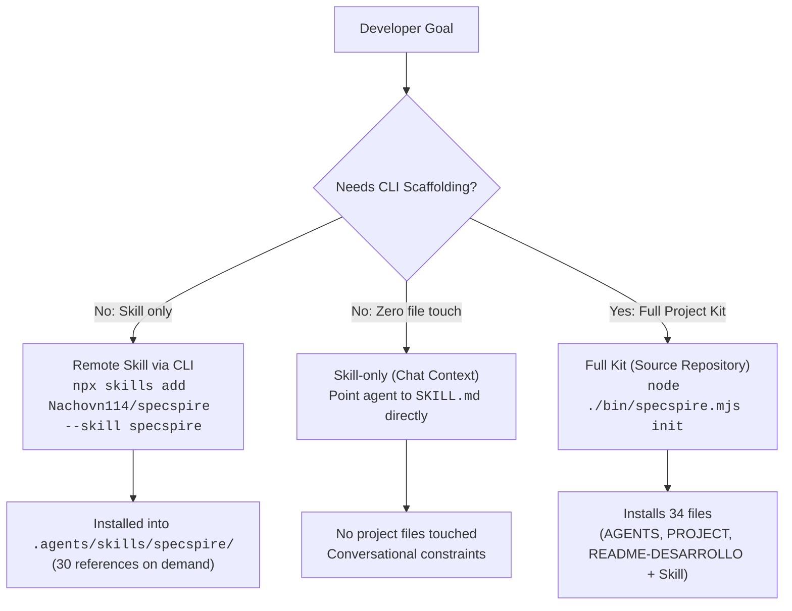

# SPECSPIRE — PASO 20E.1
## GitHub Open Source Launch Readiness & Discoverability Report

**Date:** 2026-11-02  
**Roles:** Principal Open Source Maintainer, Developer Relations Engineer, Senior Technical Writer, GitHub Release Engineer, Brand Designer & DevEx Architect  
**Repository:** `Nachovn114/specspire`  
**Branch:** `feat/github-public-launch`  
**Base Commit:** `19860cf330157eeb32396e498fe6685843d7b91c` (`main` post-PR #8)  

---

## 1. Executive Summary

Specspire was audited and elevated into a launch-ready, highly discoverable open-source repository. Prior to this milestone, Specspire held robust engineering capabilities (bilingual Phase 3 scaffolding, responsive cross-platform standards R01–R06, privacy gates P01–P06, and verified Google Antigravity discovery), but its public presentation was weighed down by internal CI audit hashes, unformatted text blocks, missing visual assets, and absent community templates.

In **Paso 20E.1**, we systematically addressed every gap without breaking contracts, altering packaging limits, or making inflated claims:
- **Brand Identity & Social Preview:** Designed an original, minimalist vector logo (`assets/logo.svg`) and high-resolution 1280×640 px GitHub Social Preview banner (`assets/social-preview.png`).
- **High-Impact Landing Page:** Re-architected `README.md` and `README.es.md` into concise (< 120 lines), developer-centric landing pages focusing on immediate utility, verified compatibility, reproducible quickstarts, and the core value proposition: **"From prompt to proof."**
- **Public Showcase:** Authored the real-world [TaskFlow ES Case Study](../case-studies/TASKFLOW_ES_CASE_STUDY.md) demonstrating the 7-phase workflow, responsive engineering (320px–1920px), privacy compliance, and how pilot feedback evolved Specspire upstream.
- **Community Infrastructure:** Implemented GitHub Issue Forms (`bug_report.yml`, `feature_request.yml`, `config.yml`) and Pull Request template (`PULL_REQUEST_TEMPLATE.md`).
- **Audit & Discoverability Strategy:** Formulated an organic distribution roadmap across skills.sh, GitHub Topics, DEV Community, and LinkedIn.
- **Strict Quality Gate:** All 146 unit, integration, identity, and privacy tests passed; source validation passed; packaging smoke test verified 68 distribution files with zero runtime dependencies.

---

## 2. Phase 1 — Public Presence & Discoverability Audit

A comparative audit was conducted against best practices established by open source developer tools (Anthropic Skills, obra/superpowers, mattpocock/skills, vercel-labs/agent-skills).

### Findings Matrix (Prioritized)

| Priority | Area | Current Baseline Issue | Resolution in Paso 20E.1 |
|---|---|---|---|
| **P0** | **Hero & Readability** | `README.md` and `README.es.md` were overwhelmed by raw CI run IDs, PR #5/#7 commit hashes, and internal disclaimers, obscuring what Specspire actually does. | Re-architected landing pages with clean hero, brand tagline, reproducible CLI command, 7-phase diagram, and moved audit hashes to `CHANGELOG.md`. |
| **P0** | **Visual Identity** | No repository logo, icon, or OpenGraph social preview existed. Shared links on GitHub, Discord, Twitter/X, and LinkedIn showed blank grey boxes. | Created scalable SVG logo (`assets/logo.svg`) and high-dpi 1280×640 px PNG banner (`assets/social-preview.png`). |
| **P0** | **Community Templates** | `.github/` lacked issue and pull request templates, leading to unstructured bug reports and missing reproduction details. | Added YAML issue forms (`bug_report.yml`, `feature_request.yml`, `config.yml`) and Markdown PR template. |
| **P1** | **Showcase & Proof** | No end-to-end real-world example was visible to prospective developers or contributors. | Published [TaskFlow ES Case Study](../case-studies/TASKFLOW_ES_CASE_STUDY.md) detailing real TDD evidence, responsive matrices, and upstream improvements. |
| **P1** | **GitHub Topics** | Limited metadata topics (`agent-skills`, `ai-coding`, `developer-tools`, `software-engineering`, `spec-driven-development`, `tdd`, `ui-ux`) missed major ecosystem tags. | Proposed adding `skills`, `ai-agent-skills`, `agentic-workflow`, `code-review`, `developer-experience`. |
| **P1** | **Compatibility Clarity** | Unclear distinction between verified environments (Google Antigravity, Linux/macOS/Windows CI) and unverified agents (Codex, Cursor, Claude Code). | Implemented structured compatibility matrix explicitly labeling PASS vs NOT VERIFIED. |
| **P2** | **Discussions & Community** | GitHub Discussions were disabled; no clear channel existed for architectural Q&A before filing bugs. | Prepared configuration and structured recommendation for enabling GitHub Discussions. |
| **P2** | **Organic Distribution** | Absence of structured guidelines for submitting Specspire to skills.sh and technical blogging communities. | Designed an organic developer relations strategy with concrete outreach templates. |

---

## 3. Phase 2 — Identity & Brand System

### Core Identity
- **Name:** Specspire
- **Tagline:** *From prompt to proof.*
- **Value Proposition:** One Agent Skill for spec-driven software engineering.
- **GitHub Description:**
  > *"One bilingual Agent Skill for spec-driven planning, test-first development, code review, and evidence-based software delivery."*

### Visual Design Tokens
- **Palette:**
  - Background Base: `#0B0F19` (Deep Obsidian Slate)
  - Card / Panel Fill: `#0F172A` / `#1E293B`
  - Border Accents: `#334155`
  - Primary Brand Gradient:
    - Base / Foundation: Indigo (`#6366F1`)
    - Architecture / Mid: Cyan (`#06B6D4`)
    - Apex / Proof: Emerald (`#10B981`)
  - Typography Base: `#F8FAFC` (High-contrast Off-White) / `#94A3B8` (Muted Slate)
- **Logo Symbolism:**
  An architectural ascending spire composed of three precision facets, representing the progressive ascent from requirements specification (foundation) to automated TDD (body) to verifiable evidence and delivery (proof spark at the peak).
- **Social Preview Asset:**
  `assets/social-preview.png` (1280×640 px, 53.8 KB, PNG optimized for fast CDN delivery and crisp display on high-DPI screens).

---

## 4. Phase 3 — GitHub Topics & Repository Metadata

### Remote Settings Recommendation (To be applied via GitHub Web UI or CLI upon approval)

1. **Description:**
   `One bilingual Agent Skill for spec-driven planning, test-first development, code review, and evidence-based software delivery.` (124 characters; well within 350-character limit).
2. **Homepage:**
   `https://github.com/Nachovn114/specspire#readme`
3. **Repository Topics (12 topics, within limit of 20):**
   ```text
   agent-skills, ai-agent-skills, agentic-workflow, ai-coding, code-review,
   developer-experience, developer-tools, skills, software-engineering,
   spec-driven-development, tdd, ui-ux
   ```
4. **GitHub Discussions:**
   Enable Discussions with four official categories:
   - 📢 **Announcements:** Release notes, prereleases, and project updates.
   - 💬 **General & Q&A:** Getting started questions, IDE configuration, harness setups.
   - 🚀 **Showcase & Pilots:** Real applications built with Specspire.
   - 💡 **Ideas & Skill Evolution:** Feature proposals and reference refactors.

---

## 5. Phase 4 — Professional README Architecture

Both `README.md` and `README.es.md` were refactored to satisfy the target 12-section architecture while strictly honoring the invariant `md.split('\n').length < 120` from `tests/docs.test.mjs`:

1. **Header / Hero:** Name, tagline, international language switcher, and direct links to core documentation.
2. **Verifiable Badges:** Live GitHub Actions CI status badge, License, Node 20+ requirement, and beta status.
3. **Quick Install:** Single copy-paste command (`npx skills add Nachovn114/specspire --skill specspire`).
4. **Beta Notice & Limitations:** Clear statement that CI matrix passes and Google Antigravity is verified, while remote bootstrap and untested agents remain `NOT VERIFIED`. Historical audit hashes migrated to `CHANGELOG.md`.
5. **Why Specspire:** Direct explanation of the AI coding agent problem (premature coding, phantom tests).
6. **Seven-Phase Workflow:** Concise visual progression from Phase 0 Context to Phase 6 Deliver.
7. **Getting Started Modes:** Clear instructions for Remote Skill (`skills add`), Skill-only (conversational), and Full Kit (`specspire init`).
8. **Verified Compatibility:** Structured table distinguishing PASS from NOT VERIFIED.
9. **Showcase Link:** Direct link to the TaskFlow ES Case Study.
10. **Documentation Matrix:** Bilingual links to Quick Start, Workflow, Quality Gates, UI Design, and CLI.
11. **Community Links:** Links to Contributing, Security policy, Changelog, and License.
12. **Line Count Compliance:** `README.md` is 73 lines; `README.es.md` is 73 lines (both < 120).

---

## 6. Phase 5 — Developer Experience & Installation Modes

Specspire provides three distinct installation tiers depending on developer needs:



### Verified Compatibility Matrix

| Environment | Status | Verification Evidence |
|---|---|---|
| **Google Antigravity** | **PASS** | Verified in Paso 20B/20B.1 interactive activation across 5 core scenarios. |
| **GitHub Actions CI Matrix** | **PASS** | 9/9 platform matrix (Ubuntu, Windows, macOS × Node 20, 22, 24) + `required` gate. |
| **Codex** | **NOT VERIFIED** | Standard Skill structure compliant; comprehensive pilot pending. |
| **Claude Code** | **NOT VERIFIED** | Standard Skill structure compliant; pilot scheduled before v1.0.0. |
| **Cursor** | **NOT VERIFIED** | Standard Skill structure compliant; pilot scheduled before v1.0.0. |

---

## 7. Phase 6 — TaskFlow ES Showcase & Case Study

The case study (`../case-studies/TASKFLOW_ES_CASE_STUDY.md`) provides technical evidence of Specspire in action:
- **Project:** TaskFlow ES (Responsive task & workflow manager in Spanish/English).
- **Phases Applied:** Completed all 7 phases from `PROJECT.md` to `review.md`.
- **TDD Evidence:** Pure reducers and UI components developed via RED-GREEN-REFACTOR.
- **Quality Gates Applied:**
  - Responsive Standards (R01–R06): Viewport meta, fluid reflow down to 320px, touch targets ≥ 44×44px, safe-area insets.
  - Privacy Gates (P01–P06): Zero tracking, transient processing without persistence.
- **Upstream Evolutions:** How the pilot directly produced improvements M01–M04 and the R06 verdict criteria integrated into Specspire `main` via PR #8.
- **Sanitization:** Zero private Windows paths, credentials, or proprietary tokens.

---

## 8. Phase 7 — Open Source Community Infrastructure

Created community files in `.github/`:
1. `.github/ISSUE_TEMPLATE/bug_report.yml`: Structured form with dropdowns for component, OS, runtime, agent harness, reproduction steps, and privacy checklist.
2. `.github/ISSUE_TEMPLATE/feature_request.yml`: Structured form targeting workflow phases, problem friction, proposed reference changes, and verification criteria.
3. `.github/ISSUE_TEMPLATE/config.yml`: Directs general questions to GitHub Discussions and vulnerabilities to `SECURITY.md`.
4. `.github/PULL_REQUEST_TEMPLATE.md`: Mandatory checklist verifying tests, source validation, packaging smoke, bilingual parity, and evidence integrity.

---

## 9. Phase 8 — Organic Discoverability & Distribution Strategy

### Ecosystem Channels
1. **skills.sh Catalog:**
   - Listing command: `npx skills add Nachovn114/specspire --skill specspire`.
   - Category: Software Engineering / TDD / Code Review.
2. **Technical Articles (DEV Community / Hashnode):**
   - Title idea: *"Why AI Coding Agents Need Specs: Building TaskFlow ES with Specspire"*.
   - Focus: Practical demonstration of how spec-driven constraints eliminate agent hallucinations and skipped tests.
3. **LinkedIn & Developer Communities:**
   - Visual post featuring `assets/social-preview.png` and the 7-phase workflow.
   - Highlighting bilingual engineering (ES/EN) and responsive mobile standards for AI-generated code.
4. **Honest Metrics Tracking:**
   - Track GitHub Stars, forks, clones, and unique visitors.
   - Track verified skill installations via `skills.sh`.
   - Monitor high-quality issues and external PR contributions.
   - **Zero tolerance:** No follow-for-follow schemes, star exchanges, or bot engagement.

---

## 10. Phase 9 — Versioning & Release Candidate Proposal

### Release Analysis
- **Current Tag:** `v0.9.0-beta.1` (2026-10-31)
- **Capabilities Added Since `v0.9.0-beta.1`:**
  - Bilingual Skill Router and 15 English references (PR #5).
  - Bilingual Project Scaffolding and English CLI templates (PR #7).
  - Pilot 1 TaskFlow ES Improvements (M01–M04, R06 verdict standard) (PR #8).
  - Launch Readiness: Visual identity, Social Preview, redesigned landing pages, TaskFlow ES case study, and GitHub community templates (Paso 20E.1).
- **Proposed Release Candidate:** `v0.10.0-beta.1`
  - **SemVer Justification:** Significant feature expansion (bilingual scaffolding, case studies, brand identity) while remaining in pre-1.0.0 beta without breaking existing CLI contracts.
  - **Release Notes Draft:** Documented in `CHANGELOG.md` under `## [Unreleased]`.
  - **Constraint Adherence:** No git tag, merge, or npm publication executed.

---

## 11. Phase 10 — Controlled Quality Gate Results

| Test / Check | Command | Result | Details |
|---|---|---|---|
| **Unit & Integration Tests** | `npm test` | **PASS (146/146)** | 146 passed, 0 failed, 3 native symlink fixtures skipped on Windows (EPERM). |
| **Markdown Link Integrity** | `tests/docs.test.mjs` | **PASS** | All relative markdown links resolve to existing files. |
| **README Invariants** | `tests/docs.test.mjs` | **PASS** | `README.md` lines < 120 (73 lines), all mandatory doc links present. |
| **Bilingual Router & Parity** | `tests/skills.test.mjs` | **PASS** | 30 references (15 ES, 15 EN) verified. |
| **Source Manifest Validation** | `npm run check` | **PASS** | 1 Skill, 30 references, 16 templates verified. |
| **Tarball Packaging Smoke** | `npm run test:package` | **PASS** | Exactly 68 distribution files; zero runtime dependencies; offline installation verified. |
| **Git Diff Whitespace Check** | `git diff --check` | **PASS** | Zero whitespace or conflict artifacts. |

---

## 12. Verification & Next Steps

All changes are staged on branch `feat/github-public-launch`. A Pull Request can now be opened for maintainer review. Merging, tagging, and publishing remain reserved for explicit maintainer authorization.
